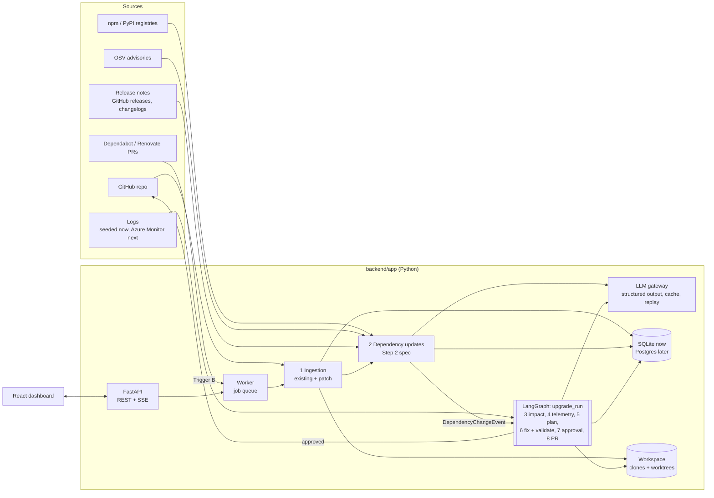
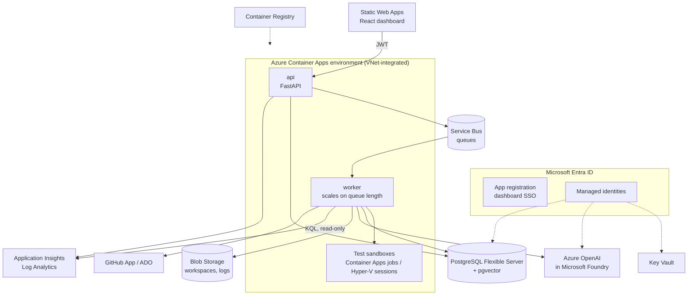

# Codebase Pilot: Production-Shaped Build Spec (v2: market fit + Azure)

> **v2 changes:** Section 2A positions Pilot against Dependabot, Renovate, JFrog and the new AI fix agents;
> Section 3.3 adds the Azure production architecture; Section 7.0B adds a second trigger (enrich
> Dependabot/Renovate PRs); telemetry gets an Azure Monitor adapter (7.2); the LLM gateway targets Azure
> OpenAI in Microsoft Foundry (7.4); the build plan adds Azure milestones (15).

> **For Claude Code.** This is the master spec for the whole system. It sits next to two companion files:
>
> | File | What it is | Where it goes |
> | --- | --- | --- |
> | `codebase-pilot-build-spec.md` (this file) | Architecture, contracts, every step after ingestion, API, UI, build plan | `docs/specs/` |
> | `dependency-update-intelligence-spec.md` | Full spec for **Step 2** (finding and analysing dependency updates) | `docs/specs/` |
> | `ingestion-fixes.patch` | Tested fixes to the existing ingestion code, applied by its owner | repo root, `git apply` |
>
> Rules for building:
> 1. Read this file and the Step 2 spec completely, then read every file in `backend/app/`.
> 2. Build only the workstream and milestone you are asked for (Section 15). Each milestone ends with its
>    acceptance tests passing.
> 3. Never edit the ingestion modules (`backend/app/*.py`) except through `ingestion-fixes.patch` or an
>    explicit request. Never write to `scans`, `nodes`, `edges` from other steps.
> 4. Contracts in Section 6 change only through a reviewed PR; say so before changing one.
> 5. Deterministic code finds and computes; the LLM only interprets text it is given, writes summaries,
>    and proposes edits. Every LLM claim that names code or a change must be checked by code.

---

## 1. What we are building

Codebase Pilot watches the third-party dependencies of a codebase. When a new version matters (breaking
changes, deprecations, security fixes), it shows **which lines of our code are affected and why, with
evidence**. It proposes and tests the fix, and opens a pull request after an engineer approves.

**Golden path for the demo (one flawless loop):**

1. Ingestion scans `pilot-sandbox-shop`, a small Express **4.21.2** app (Section 11) that uses APIs
   removed in Express 5.
2. Step 2 finds Express 5.x and reads its real release notes. It extracts the removed APIs with quotes
   and links.
3. Impact analysis finds every affected line in three ways: pattern search, Express 4's own runtime
   deprecation warnings, and an upgrade-and-test probe.
4. Seeded production logs show the same deprecation warnings are firing in production.
5. Risk, effort and a remediation plan are computed. Pilot generates the fix, upgrades Express, and the
   tests go from red to green.
6. An engineer approves in the dashboard, and Pilot opens a real PR with the bump, the code fixes and the
   evidence.
7. After merge, the next scan shows Express on 5.x and the finding closes.
8. **Same loop, second trigger:** Dependabot opens its own "bump express to 5.x" PR on the sandbox and CI
   goes red. Pilot picks the PR up, comments the evidence-backed impact report, and pushes the fix
   commit; CI turns green (Section 7.0B). This shows Pilot **adds to** the tools teams already run.

**Positioning in one line:** Dependabot and Renovate tell you *a new version exists* and open the bump;
JFrog tells you *whether a package is safe to use*; Codebase Pilot tells you *what the upgrade breaks in
your code, proves it with three kinds of evidence including production logs, and hands you a tested fix*,
for non-security upgrades and deprecations too, across every repo a team owns.

**Why Express 4 → 5:** the ingestion pipeline already handles npm and JavaScript; Express 5 is a real,
widely felt major upgrade; and Express 4 marks most of the removed APIs at runtime through `depd`
warnings that name the file and line. That gives the demo evidence from three independent sources.

---

## 2. First plan vs what exists vs what to build

The first plan (team doc, Sections 1–22) assumed a fresh Postgres + pgvector build with Python services as
the demo target. The team has since built ingestion on SQLite with a generic graph, against an npm
codebase. The recommended build keeps what works, fixes what is wrong, and makes every choice swappable
for production.

| Area | First plan | What exists now | **Recommended** | Why |
| --- | --- | --- | --- | --- |
| Data store | Postgres + pgvector | SQLite, property graph (`nodes`, `edges`, JSON properties) | **SQLite now, all SQL in `store` modules, numbered migrations; Postgres in production** | The graph model is good and flexible; SQLite costs nothing this week; a contained store layer makes the move a known job |
| Code model | Python `ast` indexer, service graph | `ast` for Python, regex for JS; files, modules, symbols, imports | **Keep, plus the patch** (per-scan ids, line numbers, correct relative/scoped resolution) | Line numbers and correct resolution are what impact analysis needs; tree-sitter is the production upgrade |
| Demo target | Internal API contract change (Python), then Pydantic | Express repo itself (already up to date) | **Sandbox Express 4.21.2 app → Express 5** | Real breaking changes, runtime evidence, matches the JS ingestion |
| Change detection | `oasdiff` for specs; LLM over release notes | — | **Registry APIs + OSV + fetched release notes, LLM extraction with quote validation** (Step 2 spec) | Grounded, citable, cacheable |
| Impact | AST + keyword + LLM + upgrade-and-test | Import graph | **Package scope from the graph → pattern search → runtime deprecation probe → upgrade-and-test probe → LLM confirmation** | Three independent signals; the LLM only confirms |
| Orchestration | One LangGraph graph of 9 nodes | Plain functions in `main.py` | **Two levels: deterministic scan pipeline (jobs) + one LangGraph graph per dependency upgrade** | One thread per upgrade makes approvals, retries and resumes independent |
| Fixes | LLM search-and-replace edits | — | **Official codemod if one exists, then LLM edits; git makes the diff; tests decide** | Codemods are deterministic; LLM handles the rest |
| Execution safety | Docker, no network | — | **Hackathon: only allowlisted repos, `--ignore-scripts`, timeouts. Production: two-phase containers** | `npm install` runs package scripts; never run arbitrary repos on a laptop |
| Delivery | Dashboard + GitHub PR comment | Console output | **FastAPI + React dashboard as the demo stage; GitHub PR as proof; GitHub App in production** | Matches the plan doc's integration principles |
| Triggers | Pilot detects changes itself | — | **Two triggers: Pilot's own scan (A) and existing Dependabot/Renovate PRs (B)** | Teams already run bump bots; Pilot makes their PRs mergeable instead of competing with them |
| Hosting | Unspecified | Laptops | **Azure: Container Apps, Azure OpenAI (Foundry), PostgreSQL Flexible Server, Service Bus, Key Vault, Monitor** (Section 3.3) | The team has Azure access; managed services cover every production need |

---

## 2A. The landscape: what existing tools do, and where Pilot fits

Checked against the vendors' current documentation (sources at the end of this section).

| Tool | What it does well | What it does not do | How Pilot uses or complements it |
| --- | --- | --- | --- |
| **Dependabot** (GitHub) | Security and version-update PRs; grouping, schedules, a default 3-day cooldown for version updates; many ecosystems | Doesn't analyse how your code uses the package or fix breaking code in version updates. Since April 2026, **security alerts** can be assigned to AI agents (Copilot, Claude, Codex), which open draft PRs and try to fix test failures; this needs GitHub Code Security + Copilot and covers alerts only | **Trigger B:** Pilot reads Dependabot PRs and alerts, adds the impact report and fix commits. Pilot's value over the agent feature: proactive analysis before CI fails, non-security upgrades and deprecations, production-log evidence, a cross-repo view, not tied to one SCM |
| **Renovate** (Mend) | 90+ package managers, changelogs embedded in PRs, grouping and presets, automerge; merge-confidence badges (Mend commercial) from crowd CI data | No code-usage analysis, no fixes for breaking code; not a vulnerability scanner | **Trigger B** (same as Dependabot). Renovate's changelog is a generic list; Pilot's report says *which of those changes hit which lines of this repo* |
| **JFrog** (Artifactory, Xray, Curation, Catalog, Frogbot) | Artifact proxy/registry; SCA and license scanning; contextual analysis of whether a CVE applies; blocking risky packages at download; Frogbot PR scans and fix PRs for vulnerabilities | Security and governance focus; its docs don't describe breaking-API analysis or code fixes for version upgrades | **Registry source:** point Pilot's npm adapter at Artifactory (same npm registry API), so it only proposes versions the company allows. Later: ingest Xray findings as `ChangeEvent`s |
| **GitLab Duo agentic breaking change resolution** (beta, Ultimate tier) | After a dependency-bump MR's **pipeline fails**, reads logs, changelogs and code usage, commits fixes, reruns | Reactive (only after CI fails), GitLab only, beta | Closest to Pilot. Pilot is proactive (impact before the bump), evidence-first (quotes, line-level findings, production logs), SCM-agnostic, and gives a portfolio view across repos and teams |

**What this means for the build:**

1. **Don't build a bump bot.** Detection of new versions stays (Step 2) because Pilot needs it for impact
   *before* a PR exists, but in production Pilot also listens to the bots teams already run (Trigger B).
2. **The moat is evidence + impact + fix + portfolio:** line-level findings from three independent signals,
   production telemetry correlation, a tested fix, and one view of every upcoming migration across repos
   and teams. Every feature should strengthen one of these.
3. **Stay SCM-agnostic:** GitHub now, with Azure DevOps Repos and GitLab adapters behind the same
   `SourceControl` interface.
4. **Pitch line for judges:** "Dependabot opens the PR. Pilot makes it mergeable, and tells you before CI
   does."

Sources: [GitHub blog: grouping, cooldown, security updates (Jul 2026)](https://github.blog/security/application-security/tame-dependabot-group-your-updates-slow-the-cadence-keep-security-fast/),
[GitHub changelog: Dependabot alerts assignable to AI agents (Apr 2026)](https://github.blog/changelog/2026-04-07-dependabot-alerts-are-now-assignable-to-ai-agents-for-remediation),
[Renovate overview (AppSec Santa, Jun 2026)](https://appsecsanta.com/renovate),
[JFrog security docs](https://docs.jfrog.com/security/docs/security),
[GitLab: agentic breaking change resolution](https://docs.gitlab.com/user/application_security/dependency_scanning/agentic-breaking-change-resolution/).

---

## 3. Target architecture



### 3.1 Principles (apply in every module)

1. **Deterministic first, LLM for judgement.** Versions, advisories, scopes, matches, test results, risk,
   effort, diffs: code. Reading notes, confirming a match, writing a plan, proposing edits: LLM.
2. **Every claim carries evidence.** A change has a quote and URL; a finding has a file, line and source;
   a fix has a diff and a test result.
3. **Idempotent everywhere.** Jobs have dedupe keys; findings, patches and PRs are keyed by upgrade; re-runs
   update rather than duplicate. A re-run with nothing new makes zero LLM calls.
4. **One failure never stops the batch.** Catch per dependency and per upgrade, record the status, continue.
5. **Human approval before anything leaves the system.** No auto-merge, ever.
6. **Swappable edges.** Store, queue, LLM provider, source control and log source sit behind small
   interfaces, so production swaps an implementation, not the design.

### 3.2 Two levels of orchestration

| Level | Unit | Runs | Engine |
| --- | --- | --- | --- |
| Scan pipeline | One repository at one commit | Ingestion → Step 2 → one `upgrade_run` job per event with risk ≥ medium | Plain Python functions chained by jobs |
| Upgrade run | One dependency upgrade in one repo | Impact → telemetry → plan → fix ↔ validate → approval → PR | **LangGraph**, one thread per run, checkpointed |

Why not one big graph: an approval inside parallel branches of one graph makes resume and retry fragile.
One thread per upgrade lets ten upgrades wait for ten different approvers without touching each other.
It is also exactly how a production worker fleet would run them.

**Triggers.** Both end in the same `upgrade_run` graph:

| Trigger | Source | Creates |
| --- | --- | --- |
| A: Pilot scan | Schedule or "Scan now" → ingestion → Step 2 | `upgrade_run` per event with risk ≥ medium; Pilot opens its own PR after approval |
| B: Bot PR | Open PR authored by `dependabot[bot]` or `renovate[bot]` that changes a manifest | `upgrade_run` on the PR's head branch; Pilot comments and (if allowed) pushes fix commits to that PR (7.0B) |

### 3.3 Azure production architecture



| Need | Azure service | Hackathon (by Friday) | Production |
| --- | --- | --- | --- |
| LLM | **Azure OpenAI in Microsoft Foundry**: two deployments, a strong model (extraction, plans, fixes) and a fast one (confirmations); both must support structured outputs | API key in `.env` | Managed identity (`DefaultAzureCredential` + bearer token provider), private endpoint, content filtering config reviewed, per-deployment quotas |
| API and worker | **Azure Container Apps** (two apps from one image, different commands) | Optional: deploy `api` with the worker in-process, 1 replica | Separate apps; worker scaled by KEDA on Service Bus queue length; health probes |
| Test execution | **Container Apps jobs** in a VNet-integrated environment, or **Hyper-V-isolated dynamic sessions / Container Apps sandboxes** (check regional availability and preview status before choosing) | Local subprocess, sandbox repo only | Two phases: install with egress allowed only to the npm registry or Artifactory; test with no network; CPU/memory/time limits |
| Database | **Azure Database for PostgreSQL Flexible Server** (enable the `VECTOR` extension in `azure.extensions`, then `CREATE EXTENSION vector`) | SQLite file (keep the demo simple and fast) | Postgres via the store layer; Entra authentication; automated backups; PITR |
| Queue | **Azure Service Bus** queues `scan`, `updates`, `upgrade`, with dead-letter queues | `jobs` table | Service Bus; same `jobs.py` interface |
| Secrets | **Key Vault**, referenced from Container Apps secrets | `.env` (never committed) | Key Vault + managed identity; no secrets in images or env files |
| Frontend | **Static Web Apps** (or a Container App serving the build) | Vite dev server or SWA free tier | SWA with Entra ID auth (MSAL), custom domain |
| Pilot's own telemetry | **Application Insights** via `azure-monitor-opentelemetry` | Optional | On, with traces across API → worker → LLM |
| Telemetry source (apps under analysis) | **Log Analytics** queried with KQL (`azure-monitor-query`) | Seeded logs; optional: deploy the sandbox app to Container Apps and query its real console logs (milestone T2) | Read-only adapter scoped per workspace and service |
| Images | **Azure Container Registry** | — | Built by GitHub Actions; pulled with managed identity |
| Source control | GitHub App (or **Azure DevOps** Repos/Boards if the client uses ADO) | Fine-grained PAT, sandbox repo | GitHub App per org; ADO via service principal |
| Package source | **Azure Artifacts** or **JFrog Artifactory** feeds (npm-compatible) | Public npm registry | `NPM_REGISTRY_URL` points at the company feed, so only approved versions are proposed |
| Infrastructure | **Bicep** + GitHub Actions with OIDC federated credentials (`azure/login`) | Portal or `az` CLI for the few resources used | All resources in Bicep, one resource group per environment (dev, prod) |

**Resource naming (dev):** `rg-codebasepilot-dev`, `cae-codebasepilot-dev`, `ca-pilot-api`, `ca-pilot-worker`,
`kv-codebasepilot-dev`, `psql-codebasepilot-dev`, `sb-codebasepilot-dev`, `acr<org>codebasepilot`,
`oai-codebasepilot-dev`, `appi-codebasepilot-dev`, `log-codebasepilot-dev`.

**Data residency and policy:** only code windows, release notes and log lines reach Azure OpenAI; all
resources in one region approved by IT; tag every resource with `app=codebase-pilot`, `env`, `owner`.

---

## 4. Repository layout

Keep the existing ingestion files where they are (no churn this week); add packages next to them.

```
codebase_pilot_/
├── docs/specs/                      # this spec + Step 2 spec
├── backend/
│   ├── requirements.txt             # pinned; see 4.1
│   ├── app/
│   │   ├── main.py, database.py, scanner.py, dependency_extractor.py,
│   │   │   python_analyzer.py, js_analyzer.py, resolver.py      # ingestion (existing)
│   │   ├── core/
│   │   │   ├── config.py            # pydantic-settings: env vars in Section 4.2
│   │   │   ├── db.py                # connect(): pragmas, migrations runner
│   │   │   ├── migrations/          # 002_dependency_updates.sql, 003_pipeline.sql
│   │   │   ├── contracts.py         # Section 6 models (single source of truth)
│   │   │   ├── llm.py               # Section 7.4
│   │   │   ├── http.py              # shared httpx client, retries, rate limits
│   │   │   ├── events.py            # run_events writer + in-process pub/sub for SSE
│   │   │   ├── jobs.py              # queue: enqueue, claim, complete, retry
│   │   │   └── workspace.py         # clones, worktrees, safe command runner
│   │   ├── updates/                 # Step 2 (companion spec)
│   │   ├── impact/                  # Step 3: scope.py, patterns.py, probes.py, confirm.py
│   │   ├── telemetry/               # Step 4: seeded.py (+ adapters later)
│   │   ├── planning/                # Step 5: risk.py, effort.py, plan.py
│   │   ├── remediation/             # Step 6: codemods.py, edits.py, validate.py
│   │   ├── actions/                 # Step 8: github.py (PRs, issues)
│   │   ├── orchestrator/            # graph.py (upgrade_run), pipeline.py (scan level), worker.py
│   │   ├── api/                     # FastAPI app, routers, SSE
│   │   └── prompts/                 # *.md prompt templates, versioned
│   ├── config/package_sources.yaml
│   └── tests/                       # unit + fixtures + e2e (replay mode)
├── frontend/                        # React + Vite + TypeScript
├── evals/                           # answer keys + run_eval.py
└── .github/workflows/ci.yml
```

The sandbox app lives in its **own GitHub repo** (`pilot-sandbox-shop`) so PRs are real.

### 4.1 Dependencies (pin exact versions in `requirements.txt` when installing)

Backend: `fastapi`, `uvicorn[standard]`, `pydantic`, `pydantic-settings`, `httpx`, `tenacity`, `langgraph`,
`langgraph-checkpoint-sqlite`, `langchain-openai` (Azure OpenAI), `azure-identity`, `node-semver`,
`packaging`, `PyYAML`, `sse-starlette`.
Azure, add when the milestone needs it: `azure-monitor-query` (T2), `azure-monitor-opentelemetry` (Z1),
`azure-servicebus` and `psycopg[binary]` + `langgraph-checkpoint-postgres` (production only).
Dev: `pytest`, `pytest-asyncio`, `respx`, `ruff`.
Frontend: `react`, `vite`, `typescript`, `@tanstack/react-query`, `react-router`, `tailwindcss`,
shadcn/ui components, a diff viewer (`react-diff-viewer-continued`), `openapi-typescript`.
Runtime tools on the worker machine: `git`, Node.js 20+ and `npm` (to run sandbox tests).

### 4.2 Configuration (environment variables; `.env.example` committed, `.env` gitignored)

| Variable | Default | Used by |
| --- | --- | --- |
| `CODEBASE_PILOT_DB` | `codebase_pilot.db` | all (already used by patched `main.py`) |
| `CODEBASE_PILOT_WORKSPACE` | `workspace` | ingestion clones, worktrees |
| `AZURE_OPENAI_ENDPOINT` | — | `core/llm.py` (e.g. `https://oai-codebasepilot-dev.openai.azure.com/`) |
| `AZURE_OPENAI_API_VERSION` | — | the API version IT's deployment supports |
| `AZURE_OPENAI_DEPLOYMENT_STRONG`, `AZURE_OPENAI_DEPLOYMENT_FAST` | — | deployment names (not model names) |
| `AZURE_OPENAI_API_KEY` | — | hackathon only; empty = use Entra ID (managed identity / `az login`) |
| `LLM_MODE` | `live` | `live` \| `record` \| `replay` |
| `NPM_REGISTRY_URL` | `https://registry.npmjs.org` | Step 2 npm adapter; set to an Artifactory or Azure Artifacts npm feed in production |
| `BOT_PR_MODE` | `comment_only` | Trigger B: `off` \| `comment_only` \| `comment_and_commit` |
| `BOT_AUTHORS` | `dependabot[bot],renovate[bot]` | Trigger B |
| `AZURE_LOG_ANALYTICS_WORKSPACE_ID` | — | Azure Monitor log source (T2) |
| `APPLICATIONINSIGHTS_CONNECTION_STRING` | — | Pilot's own telemetry (Z1) |
| `GITHUB_TOKEN` | — | Step 2 (read) and PRs (write, sandbox repo only) |
| `EXEC_ALLOWED_REPOS` | `<org>/pilot-sandbox-shop` | repos whose code may be installed and executed |
| `SEEDED_LOGS_DIR` | — | Step 4 |
| `DEMO_USER` | `demo` | approver name until SSO exists |

---

## 5. Data model

| Migration | Tables | Owner |
| --- | --- | --- |
| `001` (ingestion, `database.py`) | `scans`, `nodes`, `edges` | ingestion |
| `002_dependency_updates.sql` | `registry_packages`, `registry_versions`, `package_sources`, `vulnerabilities`, `dependency_updates`, `dependency_update_vulns`, `release_notes`, `update_analyses`, `update_changes`, `pipeline_runs` | Step 2 (DDL in its spec, Section 6) |
| `003_pipeline.sql` | `schema_migrations`, `jobs`, `upgrade_runs`, `run_events`, `impact_findings`, `telemetry_evidence`, `remediation_plans`, `patches`, `validations`, `approvals`, `pull_requests`, `llm_cache`, `feedback` | core / steps 3–8 (below) |

`core/db.py` applies `002` and `003` in order at startup, recording each in `schema_migrations`. All DDL
uses `IF NOT EXISTS`, so re-running is safe. Every connection sets:
`PRAGMA foreign_keys = ON; PRAGMA journal_mode = WAL; PRAGMA busy_timeout = 5000;`.
Check `sqlite3.sqlite_version >= "3.35"` at startup (the job claim uses `RETURNING`).

### 5.1 `003_pipeline.sql` (tested on a patched DB and on the current DB)

```sql
CREATE TABLE IF NOT EXISTS schema_migrations (
    version     TEXT PRIMARY KEY,
    applied_at  TEXT NOT NULL DEFAULT (strftime('%Y-%m-%dT%H:%M:%SZ','now'))
);

CREATE TABLE IF NOT EXISTS jobs (
    id           TEXT PRIMARY KEY,
    kind         TEXT NOT NULL,                 -- 'scan' | 'dependency_updates' | 'upgrade_run' | 'resume_upgrade'
    payload      JSON NOT NULL,
    dedupe_key   TEXT UNIQUE,                   -- e.g. 'upgrade_run:<scan>:npm:express:4.21.2->5.1.0'
    status       TEXT NOT NULL DEFAULT 'queued',-- 'queued' | 'running' | 'succeeded' | 'failed' | 'cancelled'
    attempts     INTEGER NOT NULL DEFAULT 0,
    max_attempts INTEGER NOT NULL DEFAULT 3,
    run_after    TEXT NOT NULL DEFAULT (strftime('%Y-%m-%dT%H:%M:%SZ','now')),
    locked_by    TEXT,
    locked_at    TEXT,
    error        TEXT,
    created_at   TEXT NOT NULL DEFAULT (strftime('%Y-%m-%dT%H:%M:%SZ','now')),
    finished_at  TEXT
);
CREATE INDEX IF NOT EXISTS idx_jobs_ready ON jobs(status, run_after);

CREATE TABLE IF NOT EXISTS upgrade_runs (
    id                   TEXT PRIMARY KEY,      -- also the LangGraph thread_id
    scan_id              TEXT NOT NULL REFERENCES scans(id),
    dependency_update_id INTEGER NOT NULL REFERENCES dependency_updates(id),
    ecosystem            TEXT NOT NULL,
    package              TEXT NOT NULL,
    from_version         TEXT,
    to_version           TEXT,
    status               TEXT NOT NULL DEFAULT 'queued',
        -- 'queued' | 'analyzing' | 'fixing' | 'validating' | 'awaiting_approval' | 'approved'
        -- | 'rejected' | 'pr_opened' | 'needs_engineer' | 'report_only' | 'failed'
    current_node         TEXT,
    risk_level           TEXT,
    error                TEXT,
    created_at           TEXT NOT NULL DEFAULT (strftime('%Y-%m-%dT%H:%M:%SZ','now')),
    updated_at           TEXT NOT NULL DEFAULT (strftime('%Y-%m-%dT%H:%M:%SZ','now')),
    UNIQUE (scan_id, dependency_update_id)
);

CREATE TABLE IF NOT EXISTS run_events (
    id          INTEGER PRIMARY KEY AUTOINCREMENT,
    run_id      TEXT NOT NULL,
    node        TEXT NOT NULL,
    status      TEXT NOT NULL,                  -- 'started' | 'finished' | 'waiting' | 'error'
    summary     TEXT,
    data        JSON,
    duration_ms INTEGER,
    ts          TEXT NOT NULL DEFAULT (strftime('%Y-%m-%dT%H:%M:%fZ','now'))
);
CREATE INDEX IF NOT EXISTS idx_run_events_run ON run_events(run_id, id);

CREATE TABLE IF NOT EXISTS impact_findings (
    id              INTEGER PRIMARY KEY AUTOINCREMENT,
    upgrade_run_id  TEXT NOT NULL REFERENCES upgrade_runs(id) ON DELETE CASCADE,
    change_id       INTEGER REFERENCES update_changes(id),
    file_path       TEXT NOT NULL,
    line            INTEGER NOT NULL,
    end_line        INTEGER,
    snippet         TEXT NOT NULL,
    symbol          TEXT,
    source          TEXT NOT NULL,              -- 'pattern' | 'runtime_deprecation' | 'test_failure' | 'llm'
    confidence      REAL NOT NULL,
    confirmed       INTEGER,                    -- LLM verdict: 1 | 0 | NULL
    reason          TEXT,
    UNIQUE (upgrade_run_id, file_path, line, symbol)
);

CREATE TABLE IF NOT EXISTS telemetry_evidence (
    id              INTEGER PRIMARY KEY AUTOINCREMENT,
    upgrade_run_id  TEXT NOT NULL REFERENCES upgrade_runs(id) ON DELETE CASCADE,
    source          TEXT NOT NULL,              -- 'seeded_logs' | 'datadog' | ...
    signature       TEXT NOT NULL,
    count           INTEGER NOT NULL,
    first_seen      TEXT,
    last_seen       TEXT,
    sample          TEXT,
    related_symbol  TEXT
);

CREATE TABLE IF NOT EXISTS remediation_plans (
    upgrade_run_id     TEXT PRIMARY KEY REFERENCES upgrade_runs(id) ON DELETE CASCADE,
    severity           TEXT NOT NULL,
    effort_hours       REAL NOT NULL,
    rationale          TEXT NOT NULL,
    steps_json         JSON NOT NULL,
    validation_json    JSON NOT NULL,
    created_at         TEXT NOT NULL DEFAULT (strftime('%Y-%m-%dT%H:%M:%SZ','now'))
);

CREATE TABLE IF NOT EXISTS patches (
    id              INTEGER PRIMARY KEY AUTOINCREMENT,
    upgrade_run_id  TEXT NOT NULL REFERENCES upgrade_runs(id) ON DELETE CASCADE,
    attempt         INTEGER NOT NULL,
    method          TEXT NOT NULL,              -- 'codemod' | 'llm_edits' | 'codemod+llm'
    edits_json      JSON NOT NULL,
    diff            TEXT NOT NULL,              -- produced by git, never by the LLM
    manifest_change TEXT,
    rejected_edits  JSON,
    UNIQUE (upgrade_run_id, attempt)
);

CREATE TABLE IF NOT EXISTS validations (
    id              INTEGER PRIMARY KEY AUTOINCREMENT,
    patch_id        INTEGER NOT NULL REFERENCES patches(id) ON DELETE CASCADE,
    command         TEXT NOT NULL,
    exit_code       INTEGER,
    passed          INTEGER NOT NULL,
    tests_passed    INTEGER,                    -- parsed from the runner's summary (dashboard "18 of 23 pass")
    tests_total     INTEGER,
    duration_ms     INTEGER,
    output_tail     TEXT,
    started_at      TEXT NOT NULL DEFAULT (strftime('%Y-%m-%dT%H:%M:%SZ','now'))
);

CREATE TABLE IF NOT EXISTS approvals (
    upgrade_run_id  TEXT PRIMARY KEY REFERENCES upgrade_runs(id) ON DELETE CASCADE,
    decision        TEXT NOT NULL,              -- 'approved' | 'rejected'
    decided_by      TEXT NOT NULL,
    comment         TEXT,
    decided_at      TEXT NOT NULL DEFAULT (strftime('%Y-%m-%dT%H:%M:%SZ','now'))
);

CREATE TABLE IF NOT EXISTS pull_requests (
    upgrade_run_id  TEXT PRIMARY KEY REFERENCES upgrade_runs(id) ON DELETE CASCADE,
    kind            TEXT NOT NULL,              -- 'pull_request' | 'issue'
    repo            TEXT NOT NULL,
    number          INTEGER,
    url             TEXT,
    branch          TEXT,
    state           TEXT,
    created_at      TEXT NOT NULL DEFAULT (strftime('%Y-%m-%dT%H:%M:%SZ','now'))
);

CREATE TABLE IF NOT EXISTS llm_cache (
    key         TEXT PRIMARY KEY,
    model       TEXT NOT NULL,
    response    JSON NOT NULL,
    created_at  TEXT NOT NULL DEFAULT (strftime('%Y-%m-%dT%H:%M:%SZ','now'))
);

CREATE TABLE IF NOT EXISTS feedback (
    id          INTEGER PRIMARY KEY AUTOINCREMENT,
    target_kind TEXT NOT NULL,                  -- 'impact_finding' | 'update_change'
    target_id   INTEGER NOT NULL,
    verdict     TEXT NOT NULL,                  -- 'correct' | 'not_relevant'
    user_name   TEXT,
    comment     TEXT,
    created_at  TEXT NOT NULL DEFAULT (strftime('%Y-%m-%dT%H:%M:%SZ','now'))
);
```

---

## 6. Contracts (`backend/app/core/contracts.py`)

`DependencyChangeEvent` (and its parts) is defined in the Step 2 spec, Section 9; import it from there,
don't redefine it. The new models:

```python
from typing import Literal, TypedDict
from pydantic import BaseModel

Source = Literal["pattern", "runtime_deprecation", "test_failure", "llm"]

class Finding(BaseModel):
    file_path: str
    line: int
    end_line: int | None = None
    snippet: str
    symbol: str | None = None
    change_id: int | None = None          # update_changes.id it relates to
    sources: list[Source]                 # every signal that found this line
    confidence: float                     # computed (7.1 step 6)
    confirmed: bool | None = None         # LLM verdict
    reason: str = ""

class ProbeResult(BaseModel):
    command: str
    exit_code: int | None
    passed: bool
    duration_ms: int
    output_tail: str
    timed_out: bool = False

class TelemetryEvidence(BaseModel):
    source: str
    signature: str
    count: int
    first_seen: str | None
    last_seen: str | None
    sample: str | None
    related_symbol: str | None

class Plan(BaseModel):
    severity: Literal["critical", "high", "medium", "low"]
    effort_hours: float
    rationale: str
    steps: list[str]
    validation: list[str]

class Edit(BaseModel):
    file: str            # repo-relative POSIX path
    find: str            # exact text, must occur exactly once in the file
    replace: str

class PatchResult(BaseModel):
    attempt: int
    method: Literal["codemod", "llm_edits", "codemod+llm"]
    edits: list[Edit]
    rejected: list[dict] = []
    diff: str
    manifest_change: str | None
    validation: ProbeResult | None = None

class UpgradeState(TypedDict, total=False):
    run_id: str
    event: dict                 # DependencyChangeEvent.model_dump()
    worktree: str               # absolute path of this run's git worktree
    scope_files: list[str]
    findings: list[dict]        # Finding.model_dump()
    baseline: dict              # ProbeResult on the current version
    upgrade_probe: dict         # ProbeResult on the target version, no code changes
    telemetry: list[dict]
    plan: dict
    patches: list[dict]         # PatchResult.model_dump(), one per attempt
    attempts: int
    decision: Literal["approved", "rejected"] | None
    decided_by: str | None
    links: list[str]
    route: str                  # 'full' | 'report_only' | 'needs_engineer'
```

Keep state small and JSON-serialisable (dicts, not model objects): the checkpointer stores it after every
node. Large data (diffs, logs) lives in tables; state keeps ids and summaries.

---

## 7. The steps after ingestion

Step 1 (ingestion) is the existing code plus `ingestion-fixes.patch` (described in the Step 2 spec,
Section 2.0.1). Step 2 is fully specified in the Step 2 spec. This section specifies Steps 3–8 and the
scan-level wiring.

### 7.0 Scan pipeline (`orchestrator/pipeline.py`)

```text
job 'scan' {repo_url}
  → ingestion (patched main.process_github_url, returning scan_id)
  → job 'dependency_updates' {scan_id}
      → Step 2 run_dependency_updates(db_path, scan_id) → events
      → for each event with risk_level in (critical, high, medium):
            insert upgrade_runs row, enqueue job 'upgrade_run' {run_id}
            dedupe_key = f"upgrade_run:{scan_id}:{ecosystem}:{package}:{from}->{to}"
      → events with risk 'low' → upgrade_runs row with status 'report_only' (visible in UI, no graph)
```

The patched `process_github_url` prints and returns nothing. Add a thin wrapper `ingest(repo_url) -> scan_id`
in `orchestrator/pipeline.py` that calls the same functions in the same order (see `main.py`) and
returns the id. Don't change `main.py` behaviour.

### 7.0B Trigger B: enrich Dependabot / Renovate PRs (`orchestrator/bot_prs.py`)

**Detect (poll now, webhook in production).** Every 60 s, for each onboarded repo:
`GET /repos/{o}/{r}/pulls?state=open&per_page=50`, keep PRs whose `user.login` is in `BOT_AUTHORS` and
whose `head.sha` hasn't been processed (`dedupe_key = "botpr:{repo}:{number}:{head_sha}"`). Production uses
the GitHub App's `pull_request` webhook (`opened`, `synchronize`) and `check_suite` (`completed`) events.

**Work out what changed deterministically (don't parse PR titles).** Fetch the manifest at both ends:
`GET /repos/{o}/{r}/contents/package.json?ref={base.sha}` and `?ref={head.sha}` (raw `Accept` header),
then diff `dependencies`, `devDependencies`, `peerDependencies`, `optionalDependencies`. Every changed
entry is `(package, old_constraint, new_constraint, dependency_type)`. Titles and branch names
(`dependabot/npm_and_yarn/express-5.1.0`, `renovate/express-5.x`) are only shown in the UI.

**Build the event without a new scan.** Reuse Step 2 for the facts: resolve `from` (old constraint at
the base commit's date) and `to` (new constraint at the head commit's date) with the same version logic,
fetch notes for `(from, to]` and extract changes (cache hits are likely, since Trigger A may have analysed
the same range). Run ingestion on the **base commit** if there is no recent scan of this repo, so the
package scope and line numbers exist.

**Run the same `upgrade_run` graph with two differences:**

| Node | Trigger A (Pilot PR) | Trigger B (bot PR) |
| --- | --- | --- |
| `prepare` | Worktree at the scan commit | Worktree at the PR's **head** commit (the bump is already applied) |
| `impact` | Upgrade probe installs the target | The head commit *is* the upgrade: its test run is the upgrade probe; the runtime-deprecation probe runs on the **base** commit |
| `fix` | Edits + manifest bump | Edits only (the bot already bumped the manifest and lockfile) |
| `act` | Opens Pilot's own PR | Posts or updates one comment on the bot PR (impact report, findings with links, test results); if `BOT_PR_MODE=comment_and_commit` **and approved**, commits the fix to the bot PR's branch through the contents API |

**Rules for bot PRs:**

- One Pilot comment per PR, found by a hidden marker (`<!-- codebase-pilot:{run_id} -->`) and **edited in
  place** on every new head SHA; never a new comment per push.
- Committing to a bot's branch changes how the bot treats it: Renovate stops updating a branch someone
  else modified, and Dependabot stops rebasing it automatically. Say this in the comment, and default to
  `comment_only` so teams opt in.
- If the PR's CI is already green and no findings exist, post a short "no impact found" comment (or
  nothing, per config); this keeps noise low.
- Never approve or merge the bot's PR.

**Demo setup:** commit `.github/dependabot.yml` to the sandbox (npm, weekly) with `express` allowed for
major updates. If the bot's timing doesn't fit the demo, open the same bump PR by hand and add your
GitHub username to `BOT_AUTHORS` for the demo only; the trigger logic is identical.

### 7.1 Step 3: impact analysis (`impact/`)

**Goal:** a list of `Finding`s, every affected line with how we know. Built for JavaScript first; the same
interfaces take a Python implementation later.

1. **Workspace.** Create a git worktree for this run from the kept clone at the scan's commit:
   `git -C <scans.repository_path> worktree add --detach <workspace>/runs/<run_id> <commit_sha>`.
   Remove it in a `finally` block at the end of the run (`git worktree remove --force`).

2. **Package scope (graph).** Files that import the package directly, plus internal files they import,
   up to 3 hops. In Express apps, route handlers often never import `express` themselves: they receive
   `req` and `res` from a file that does. Tested query (requires the patch for correct relative imports):

   ```sql
   WITH RECURSIVE
   importers(file_id) AS (
       SELECT DISTINCT i.source_id
       FROM edges r
       JOIN edges i ON i.target_id = r.source_id AND i.type = 'IMPORTS' AND i.scan_id = r.scan_id
       WHERE r.type = 'RESOLVES_TO' AND r.scan_id = :scan AND r.target_id = :dep
   ),
   scope(file_id, depth) AS (
       SELECT file_id, 0 FROM importers
       UNION
       SELECT r.target_id, s.depth + 1
       FROM scope s
       JOIN edges i ON i.source_id = s.file_id AND i.type = 'IMPORTS' AND i.scan_id = :scan
       JOIN edges r ON r.source_id = i.target_id AND r.type = 'RESOLVES_TO' AND r.scan_id = :scan
       WHERE r.target_id LIKE 'file:%' AND s.depth < 3
   )
   SELECT substr(file_id, 6) AS path, min(depth) AS depth
   FROM scope GROUP BY file_id ORDER BY depth, path;
   ```

   On the Express repo, `express-session` gives 4 direct files + `examples/mvc/lib/boot.js` at depth 1
   (with the patch it also follows the examples' `require('../..')` into Express's own `lib/`, because
   that repo is the library itself; an application like the sandbox doesn't have this). Cap scope at
   300 files and log when the cap is hit.

3. **Pattern search (deterministic).** For every change in the event with `api_symbols`, build patterns
   and search scope files (skip `node_modules`, minified files, files > 1 MB). Rules for a symbol
   `obj.method`:
   - Method call: `\.method\s*\(` (receiver names vary: `req`, `request`, `r`); confidence 0.6.
   - Exact receiver match `\bobj\.method\s*\(`: confidence 0.8.
   - Bare identifiers (an option or config key like `extended`): `\bkey\s*:` inside the scope files;
     confidence 0.4.
   - Route strings for path-syntax changes (e.g. a bare `*` route): `\.(get|post|put|patch|delete|all|use)\s*\(\s*['"][^'"]*\*`;
     confidence 0.6.
   Record file, line, the line's text as snippet, symbol, `source='pattern'`.

4. **Runtime deprecation probe (current version).** Many Express-ecosystem packages report deprecated
   calls at runtime through `depd`, naming the caller's file and line. Run the test suite once on the
   current version and parse stderr:
   - Command: `npm ci --ignore-scripts` (or `npm install --ignore-scripts` if no lockfile), then `npm test`,
     with `NO_COLOR=1` and the timeouts in 7.6.
   - Parse with this tested function; each hit becomes a `Finding` with `source='runtime_deprecation'`,
     confidence 1.0:

   ```python
   import re

   DEPD_RE = re.compile(
       r"(?P<pkg>@?[\w./-]+) deprecated (?P<msg>.+?)\s+(?:at\s+)?"
       r"(?P<file>[^\s:]+(?:\.[cm]?[jt]sx?)):(?P<line>\d+):(?P<col>\d+)\s*$"
   )

   def parse_deprecations(stderr: str, repo_root: str) -> list[dict]:
       out, seen = [], set()
       root = repo_root.rstrip("/\\").replace("\\", "/") + "/"
       for raw in stderr.splitlines():
           m = DEPD_RE.search(raw.strip())
           if not m:
               continue
           path = m["file"].replace("\\", "/")
           if path.startswith(root):
               path = path[len(root):]
           if "node_modules/" in path:
               continue
           key = (m["pkg"], m["msg"], path, int(m["line"]))
           if key not in seen:
               seen.add(key)
               out.append({"package": m["pkg"], "message": m["msg"], "file_path": path,
                           "line": int(m["line"]), "column": int(m["col"])})
       return out
   ```

   Tested on lines such as
   `Wed, 28 Oct 2026 05:12:00 GMT express deprecated req.param(name): Use req.params, req.body, or req.query instead at routes/orders.js:12:15`
   (with and without the timestamp or `at`, absolute or relative paths, `node_modules` callers ignored).
   M3a must confirm the exact format against real output from the sandbox and adjust the regex if needed.

5. **Upgrade-and-test probe (target version, no code changes).** In the worktree:
   `npm install <package>@<target> --save-exact --ignore-scripts`, then `npm test`. Failing tests whose
   stack frames point into repo files (not `node_modules`) become findings with `source='test_failure'`,
   confidence 0.9. The probe result (`ProbeResult`) is stored in state as `upgrade_probe`; it also tells
   the plan whether the upgrade is breaking in practice. **This probe still works when release notes are
   unavailable**, which is the fallback for `notes_unavailable` events.

6. **Merge and score.** Merge findings on `(file_path, line)` and collect `sources`. Confidence = the
   maximum of the sources' confidences, +0.1 per extra independent source, capped at 1.0. Attach
   `change_id` by matching the finding's symbol or deprecation message to `update_changes.api_symbols`.

7. **LLM confirmation** (only for findings whose sources are just `pattern`). Send ±15 lines of code per
   finding in batches of 8 with ids, plus the relevant change descriptions. Output per id:
   `{id, affected: bool, reason}`. Ids not sent are rejected. Findings marked not affected stay in the table
   with `confirmed = 0` and are hidden by default in the UI (never deleted).

8. **Persist** to `impact_findings` (unique on run, file, line, symbol) and emit events.

### 7.2 Step 4: telemetry (`telemetry/`)

Interface: `class LogSource(Protocol): def query(self, service: str, start: datetime, end: datetime) -> Iterable[LogLine]`.

- Now: `SeededLogSource` reads JSON-lines files from `SEEDED_LOGS_DIR`:
  `{"ts": "...", "service": "shop-api", "level": "warn", "msg": "...", "route": "/orders/:id"}`.
- Signatures: normalise numbers, ids and timestamps; group by signature over the last 7 days of the file.
- Evidence = signatures that contain a finding's symbol or deprecation message (deterministic match),
  with count, first and last seen, and one sample. The LLM writes nothing here.
- **Azure Monitor adapter (`AzureMonitorLogSource`, milestone T2):** read-only KQL over a Log Analytics
  workspace with `azure-monitor-query`, authenticated by `DefaultAzureCredential` (the identity needs the
  **Log Analytics Reader** role on the workspace):

  ```python
  from datetime import timedelta
  from azure.identity import DefaultAzureCredential
  from azure.monitor.query import LogsQueryClient, LogsQueryStatus

  KQL = """
  ContainerAppConsoleLogs_CL
  | where ContainerAppName_s == app_name and Log_s has "deprecated"
  | project TimeGenerated, Log_s
  | order by TimeGenerated desc
  | take 5000
  """

  def query_deprecations(workspace_id: str, app_name: str, days: int = 7):
      client = LogsQueryClient(DefaultAzureCredential())
      query = f"let app_name = '{app_name.replace(chr(39), '')}';\n" + KQL
      result = client.query_workspace(workspace_id, query, timespan=timedelta(days=days))
      if result.status != LogsQueryStatus.SUCCESS:
          raise RuntimeError(f"Log query incomplete: {getattr(result, 'partial_error', None)}")
      return [dict(zip(t.columns, row)) for t in result.tables for row in t.rows]
  ```

  Table and column names depend on how the Container Apps environment sends logs: with a Log Analytics
  destination they are `ContainerAppConsoleLogs_CL` / `Log_s` / `ContainerAppName_s`; with the Azure Monitor
  destination (diagnostic settings) `ContainerAppConsoleLogs` / `Log` / `ContainerAppName`. Make the table
  and column names config values and check them in the workspace before T2.
- Other production adapters: Application Insights (`AppTraces`, `AppExceptions`), Datadog, Splunk, Loki;
  each read-only and scoped to the service.

### 7.3 Step 5: plan (`planning/`)

All numbers are computed in code; the LLM writes only the rationale and step wording from those facts.

| Severity | Rule (first match wins) |
| --- | --- |
| critical | Upgrade probe fails **and** telemetry shows the affected path in production; or a critical/high vulnerability |
| high | Upgrade probe fails; or ≥ 1 confirmed finding with a breaking change |
| medium | Only deprecation findings; or runtime requirement change; or medium vulnerability |
| low | No findings and the upgrade probe passes |

Effort (hours) = 0.25 × confirmed findings + 0.5 × distinct files touched + 1.0 if the manifest changes +
1.0 for review and deploy, rounded up to the nearest 0.5.

The plan prompt (`prompts/plan_v1.md`) receives: the event summary, findings grouped by change, probe
results, telemetry evidence, severity and effort. It returns `{rationale, steps[], validation[]}`.

Routing after the plan: `low` → `report_only` (end); otherwise continue to fixes.

### 7.4 LLM gateway (`core/llm.py`)

```python
from functools import lru_cache
from langchain_openai import AzureChatOpenAI

@lru_cache(maxsize=2)
def _model(tier: str) -> AzureChatOpenAI:
    deployment = settings.azure_openai_deployment_strong if tier == "strong" else settings.azure_openai_deployment_fast
    auth = {}
    if settings.azure_openai_api_key:                       # hackathon
        auth["api_key"] = settings.azure_openai_api_key
    else:                                                   # production: managed identity / az login
        from azure.identity import DefaultAzureCredential, get_bearer_token_provider
        auth["azure_ad_token_provider"] = get_bearer_token_provider(
            DefaultAzureCredential(), "https://cognitiveservices.azure.com/.default")
    return AzureChatOpenAI(azure_endpoint=settings.azure_openai_endpoint,
                           azure_deployment=deployment,
                           api_version=settings.azure_openai_api_version,
                           temperature=0, timeout=60, max_retries=3, **auth)

def chat(structured_schema, *, prompt_version: str, messages: list[dict], tier: str = "strong"):
    """One entry point for every LLM call. Handles cache, replay mode, retries and tracing."""
    model_id = f"{tier}:{settings.azure_openai_deployment_strong if tier == 'strong' else settings.azure_openai_deployment_fast}"
    key = sha256_json([model_id, prompt_version, messages, structured_schema.model_json_schema()])
    if settings.llm_mode in ("replay", "record") and (hit := cache_get(key)):
        return structured_schema.model_validate(hit)
    if settings.llm_mode == "replay":
        raise LLMReplayMiss(key)                      # tests fail loudly instead of calling the network
    result = _model(tier).with_structured_output(structured_schema, method="json_schema").invoke(messages)
    cache_put(key, model_id, result.model_dump())
    return result
```

- `tier="fast"` for impact confirmations; `tier="strong"` for change extraction, plans and fixes.
- Some models reject `temperature` (reasoning models). If IT's deployment is one of those, drop it in
  `_model` and rely on structured output for determinism.
- Azure OpenAI content filters can block a response (HTTP 400 with a content-filter error code). Treat that
  as a per-item failure with a clear status, not a crash.
- Rate limits (HTTP 429) are retried by the client; set `max_retries` and keep batch sizes modest. Ask IT for
  enough tokens-per-minute quota on both deployments for the demo.

- Every prompt lives in `backend/app/prompts/<name>_v<N>.md`; bump N when wording changes.
- Untrusted text (release notes, code, logs) goes inside clear delimiters, with the instruction that it is
  data. The LLM never gets tools in these calls.
- `LLM_MODE=replay` makes CI and the stage demo deterministic and offline.
- `python -m app.core.llm --smoke` sends one tiny structured request to each deployment and prints the
  result and latency; it is the Z0 acceptance test. Check `AzureChatOpenAI` arguments against the
  installed `langchain-openai` version there.

### 7.5 Step 6: fix and validate (`remediation/`)

**Fix strategy, in order:**

1. **Official codemod** if one exists for this upgrade. Express publishes v5 migration codemods. Confirm
   the npm package name and command (e.g. `npx @expressjs/codemod ...`) before relying on it, and pin its
   version. Run it in the worktree; the diff comes from `git diff`.
2. **LLM edits** for anything the codemod didn't change (findings still present after step 1).
   Prompt `prompts/fix_v1.md` receives: each remaining finding with ±20 lines, the change description and
   migration hint with its evidence quote, and on retries the failing test output tail. It returns
   `list[Edit]`.
3. **Manifest bump:** `npm install <pkg>@<target> --save-exact --ignore-scripts` (updates `package.json`
   and the lockfile).

**Edit rules (enforced in code; violations go to `rejected_edits`, never applied):**

- `file` must be in the package scope or be a test file of a scope file; no paths outside the worktree
  (resolve and compare real paths), no `package.json`/lockfile edits (step 3 owns those).
- `find` must occur **exactly once** in the current file content.
- At most 30 edits and 200 changed lines per attempt.
- After applying: `node --check` on each changed `.js` file; a syntax error rejects that file's edits.

**Validate:** `npm test` in the worktree (7.6 limits). Record a `validations` row. If it fails and
`attempts < 3`, go back to LLM edits with the failure tail (max 2 retries). Still failing → route
`needs_engineer`: the plan, findings and best patch are still shown, and an issue is created instead
of a PR.

### 7.6 Safe execution (`core/workspace.py`)

Running a repository's install and tests runs its code. Rules:

| Rule | Hackathon | Production |
| --- | --- | --- |
| Which repos | Only `EXEC_ALLOWED_REPOS` (the sandbox); others get static analysis only | Any onboarded repo, in sandboxes only |
| Install | `npm ci --ignore-scripts` (no package lifecycle scripts) | Phase 1: Container Apps job (or Hyper-V session/sandbox) whose egress allows only the npm registry or Artifactory; `--ignore-scripts`; `node_modules` saved to Blob or a shared volume |
| Tests | Local subprocess, `cwd` = worktree, env stripped to `PATH`, `HOME`, `NO_COLOR`, `CI=true` | Phase 2: same image with **no** egress, non-root, CPU/memory limits; results written back through the worker |
| Time | 120 s install, 180 s tests, then kill the process group | same, enforced by the runtime |
| Output | Keep the last 200 lines; redact tokens | same |
| Secrets | Never pass `GITHUB_TOKEN` or LLM keys into the child environment | same |

Use `subprocess.run([...], shell=False)` with an argument list, never a shell string.

### 7.7 Step 7: approval (LangGraph interrupt)

- The `approval` node calls `interrupt({...})` with a payload summary and **does nothing before it**: on
  resume the node re-runs from its first line.
- `POST /upgrades/{run_id}/decision {decision, comment}` stores an `approvals` row, then resumes the graph
  with `Command(resume={"decision": ..., "by": ...})` in a background job (`resume_upgrade`).
- Approval is offered only when the latest patch passed validation, or for `needs_engineer` (approve
  creates an issue, not a PR).

### 7.8 Step 8: actions (`actions/github.py`)

Use the GitHub REST API through the shared `httpx` client (the patch content is small, so there is no
`git push` and no token in a remote URL).

1. If `pull_requests` already has a row for this run, return it (idempotent).
2. Branch `pilot/<package>-<target>` (sanitised). Look for an existing open PR:
   `GET /repos/{o}/{r}/pulls?head={o}:{branch}&state=open`. If one exists, update it rather than opening
   another.
3. Base SHA: `GET /repos/{o}/{r}/git/ref/heads/{base}`; create the branch: `POST /repos/{o}/{r}/git/refs`.
4. For each changed file (code edits, `package.json`, lockfile): `GET /contents/{path}?ref={branch}` for
   the blob `sha`, then `PUT /contents/{path}` with the base64 content, `sha`, `branch` and a message.
5. `POST /repos/{o}/{r}/pulls` with title `Upgrade <pkg> <from> → <to> (Codebase Pilot)` and a body that
   contains: the summary, a table of changes with evidence links, findings with file:line links
   (`https://github.com/{o}/{r}/blob/{branch}/{path}#L{line}`), test results before and after, telemetry
   evidence, approver and run link.
6. Label `codebase-pilot`, `dependencies` (create labels if missing; ignore 422 "already exists").
7. `needs_engineer` route → `POST /repos/{o}/{r}/issues` with the same body and the failing test tail.

The token needs `contents: write`, `pull_requests: write`, `issues: write` **on the sandbox repo only**.

### 7.9 The upgrade graph (`orchestrator/graph.py`)

```python
from langgraph.graph import StateGraph, START, END
from langgraph.types import interrupt, Command

def build_upgrade_graph(checkpointer):
    g = StateGraph(UpgradeState)
    g.add_node("prepare", prepare)            # load event, create worktree, compute scope
    g.add_node("impact", impact)              # pattern + probes + merge + LLM confirm
    g.add_node("telemetry", telemetry)
    g.add_node("plan", plan)
    g.add_node("fix", fix)                    # codemod → LLM edits → manifest bump; attempts += 1
    g.add_node("validate", validate)
    g.add_node("approval", approval)          # interrupt only
    g.add_node("act", act)                    # PR or issue
    g.add_node("finish", finish)              # status, cleanup worktree

    g.add_edge(START, "prepare")
    g.add_edge("prepare", "impact")
    g.add_edge("impact", "telemetry")
    g.add_edge("telemetry", "plan")
    g.add_conditional_edges("plan", lambda s: "finish" if s["route"] == "report_only" else "fix",
                            ["fix", "finish"])
    g.add_edge("fix", "validate")
    g.add_conditional_edges("validate", after_validate, ["fix", "approval"])
    g.add_conditional_edges("approval", lambda s: "act" if s["decision"] == "approved" else "finish",
                            ["act", "finish"])
    g.add_edge("act", "finish")
    g.add_edge("finish", END)
    return g.compile(checkpointer=checkpointer)

def after_validate(s):
    # The validate node sets route = "needs_engineer" once 3 attempts have failed.
    if s.get("route") == "needs_engineer":
        return "approval"
    last = s["patches"][-1]
    return "approval" if last["validation"] and last["validation"]["passed"] else "fix"

def approval(state):
    answer = interrupt({"run_id": state["run_id"], "route": state["route"]})
    return {"decision": answer["decision"], "decided_by": answer["by"]}
```

- Checkpointer: `SqliteSaver` from `langgraph-checkpoint-sqlite` on a **separate file**
  (`checkpoints.db`), so LangGraph's tables never mix with ours; `PostgresSaver` in production.
- `thread_id = upgrade_runs.id`.
- Set `route = "needs_engineer"` inside the `validate` node when retries are exhausted (nodes return state
  updates; routing functions only read).
- Every node is wrapped by a `@traced("node_name")` decorator that writes `run_events` (started, finished
  or error, duration, one-line summary), updates `upgrade_runs.status/current_node`, and re-raises errors.
- The `prepare` node is idempotent: if the worktree already exists for this run, reuse it.
- Clean up the worktree in `finish`, and also on failure (the worker's `finally`).

### 7.10 Worker (`orchestrator/worker.py`)

One worker process (or a thread started with the API for the demo) loops: claim → run → complete.

```sql
UPDATE jobs
   SET status = 'running', locked_by = :worker, attempts = attempts + 1,
       locked_at = strftime('%Y-%m-%dT%H:%M:%SZ','now')
 WHERE id = (SELECT id FROM jobs
              WHERE status = 'queued' AND run_after <= strftime('%Y-%m-%dT%H:%M:%SZ','now')
              ORDER BY created_at LIMIT 1)
   AND status = 'queued'
RETURNING id, kind, payload, attempts, max_attempts;
```

- Success → `succeeded`. Exception → if `attempts < max_attempts`, back to `queued` with
  `run_after = now + 30 s × 2^attempts`, else `failed` with the error.
- On startup, return jobs stuck in `running` for more than 15 minutes to `queued` (crash recovery).
- Production: Postgres `FOR UPDATE SKIP LOCKED` with many workers, or a broker (Azure Service Bus, SQS,
  Redis); the `jobs.py` interface stays the same.

---

## 8. API (`backend/app/api/`, FastAPI)

| Method | Path | Purpose |
| --- | --- | --- |
| GET | `/health` | DB reachable, migrations applied, LLM mode, worker heartbeat |
| POST | `/scans` `{repo_url}` | Enqueue a scan; returns `{job_id}` |
| GET | `/scans` | Scans, newest first (repo, commit, time, counts) |
| GET | `/scans/{scan_id}/dependencies` | `dependency_updates` rows, sorted by priority |
| GET | `/dependency-updates/{id}` | Full `DependencyChangeEvent` with changes and evidence |
| GET | `/upgrades?status=` | Upgrade runs (approval inbox = `awaiting_approval`) |
| GET | `/upgrades/{run_id}` | Run, findings, telemetry, plan, patches, validations, approval, PR |
| GET | `/upgrades/{run_id}/events` | **SSE**: replays `run_events` from `Last-Event-ID`, then streams new ones |
| POST | `/upgrades/{run_id}/decision` `{decision, comment}` | Approve or reject; enqueues the resume |
| POST | `/upgrades/{run_id}/retry` | Re-enqueue a failed run |
| POST | `/feedback` `{target_kind, target_id, verdict, comment}` | "Correct" or "not relevant" on findings and changes |
| PUT | `/package-sources/{ecosystem}/{name}` | Manual source mapping (Step 2) |

- SSE event shape: `id: <run_events.id>`, `data: {"run_id","node","status","summary","ts","data"}`.
  Replay from the table first, so a browser refresh during the demo loses nothing.
- Generate the frontend types: `npx openapi-typescript http://localhost:8000/openapi.json -o frontend/src/api/types.ts`.
- CORS for the Vite dev origin only.
- Production: SSO (OIDC) in front of the API; repository visibility mirrors source-control permissions.

---

## 9. Frontend (`frontend/`)

| Page | Shows | Key interactions |
| --- | --- | --- |
| **Repositories & scans** | Repos, latest scan, counts (deps, updates, critical) | "Scan now" (`POST /scans`) |
| **Dependencies** (per scan) | Table: risk badge, package, type, current → target, update type, vulns, breaking changes count, used-in files, status | Filter by risk/status; click → detail |
| **Dependency detail** | Summary; changes list with kind, breaking flag, **quote + link** per change; vulnerabilities; importing files | "Not relevant" feedback per change |
| **Upgrade run** | Header (status, risk, effort); tabs: **Findings** (file:line, code snippet, source chips: pattern / runtime / test / LLM), **Evidence** (telemetry), **Plan**, **Diff** (side by side), **Tests** (before/after), **Trace** (live SSE timeline) | Approve / Reject (disabled unless allowed; one in-flight request); "Not relevant" per finding |
| **Approvals inbox** | Runs awaiting approval, oldest first | Opens the run |

- Every component has loading, empty and error states (build them on Day 1 against fixture JSON).
- Source chips use one fixed colour per source; the risk badge is the only strong colour on a row.
- Links to GitHub open in a new tab (`#L<line>` anchors).

---

## 10. Quality and evaluation

| Layer | What | Tooling |
| --- | --- | --- |
| Unit | Every deterministic function: version logic, parsers, scope query, pattern builder, edit rules, risk and effort rules, depd parser | `pytest` |
| HTTP | Registry, OSV, GitHub calls against recorded fixtures | `respx`; `scripts/record_fixtures.py` records once |
| LLM | All LLM-using functions in `LLM_MODE=replay` with cached responses; a fake model for edge cases | `llm_cache` fixtures |
| Graph | The upgrade graph with all nodes stubbed: pause at approval, resume, retry loop, report_only route | `pytest` with `SqliteSaver` on a temp file |
| End to end | Sandbox: scan → events → upgrade run → patch → tests green → approval → (PR mocked) | `pytest -m e2e`, replay mode, no network |
| Evals | Precision and recall of findings against `evals/sandbox-shop.answer_key.yaml`; share of extracted changes whose quotes validate | `evals/run_eval.py`, run in CI and before the demo |
| Static | `ruff`, `tsc --noEmit`, `eslint` | CI |

**Targets for the demo:** findings recall 1.0 and precision ≥ 0.9 on the sandbox; 100% of displayed changes
have a validated quote; scan to PR-ready in under 5 minutes in replay mode.

CI (`.github/workflows/ci.yml`): backend lint and tests (replay mode, no secrets), frontend type check and
build, eval script with thresholds.

---

## 11. The sandbox repository (`pilot-sandbox-shop`)

A small Express app in its own GitHub repo. Every planted usage is listed in the answer key, and the tests
pass on the current version.

```
pilot-sandbox-shop/
├── package.json            # "express": "4.21.2" (exact), mocha, supertest; "test": "mocha"
├── package-lock.json       # committed (npm ci needs it)
├── app.js                  # creates the app, mounts routes, error handler
├── routes/orders.js        # GET /orders/:id uses req.param('id'); POST /orders uses res.json(order, 201)
├── routes/invoices.js      # GET /invoices/:id/pdf uses res.sendfile(path)
├── routes/admin.js         # app.del('/admin/cache', ...); res.send(204)
├── routes/i18n.js          # req.acceptsLanguage('en')
├── routes/fallback.js      # app.get('*', ...) catch-all
├── lib/notify.js           # no express usage (a negative control for precision)
├── test/*.test.js          # supertest tests covering each route
├── logs/shop-api.jsonl     # seeded logs (copy into SEEDED_LOGS_DIR)
└── .codebase-pilot.yml     # mode: assisted, test_command: "npm test"
```

| Planted usage | Express 4.21.2 at runtime | Express 5 |
| --- | --- | --- |
| `req.param('id')` | `depd` warning | removed → TypeError |
| `res.json(obj, 201)` | `depd` warning | signature removed |
| `res.sendfile(path)` | `depd` warning | removed → use `res.sendFile` |
| `app.del(path, fn)` | `depd` warning | removed → `app.delete` |
| `res.send(204)` | `depd` warning | number body no longer a status → `res.sendStatus` |
| `req.acceptsLanguage('en')` | `depd` warning | removed → `req.acceptsLanguages` |
| `app.get('*', fn)` | works | new path syntax: unnamed wildcard throws at startup → `/*splat` |

**Verification for M-S (sandbox milestone):** run the tests on 4.21.2 (green) and capture stderr. Every
row marked "depd warning" must appear in it; drop or adjust any row that doesn't. Then confirm each
removal is stated in the Express 5 release notes that Step 2 fetches (`History.md` / release `5.0.0`).
The answer key lists only verified rows:

```yaml
# evals/sandbox-shop.answer_key.yaml
package: express
from: 4.21.2
expected_findings:
  - {file: routes/orders.js,   symbol: req.param,  line: 12}
  - {file: routes/orders.js,   symbol: res.json,   line: 20}
  - {file: routes/invoices.js, symbol: res.sendfile, line: 9}
  # ... one entry per planted usage, with real line numbers once written
negatives:
  - lib/notify.js
```

**Seeded logs** (`logs/shop-api.jsonl`, about 300 lines over 7 days): normal request logs, plus the same
`express deprecated req.param(name)...` and `res.sendfile` warnings appearing on `/orders/:id` and
`/invoices/:id/pdf` requests. That gives the telemetry step real matches.

---

## 12. Security checklist

- Tokens only from environment; never logged, never passed to child processes; redact in errors.
- GitHub token scoped to the sandbox repo for writes; read-only elsewhere.
- Only `EXEC_ALLOWED_REPOS` are executed; `--ignore-scripts` on every install.
- Paths from the LLM are resolved and checked against the worktree root before any write.
- Release notes, code and logs are untrusted input to the LLM: delimited, no tools, schema-only output.
- Only the company-approved LLM endpoint; record model and prompt version on every output (audit).
- The dashboard shows only repos the user can read (production: SSO + source-control permissions).

---

## 13. Observability of Pilot itself

- `run_events` drives the live trace and is the audit log of every run.
- Structured JSON logs (`logging` + `python-json-logger` or `structlog`) with `run_id`, `node`, `job_id`.
- Azure: `azure-monitor-opentelemetry` (`configure_azure_monitor()` at startup when
  `APPLICATIONINSIGHTS_CONNECTION_STRING` is set) sends traces, logs and metrics from API and worker to
  Application Insights; add `run_id` and `node` as span attributes.
- Optional: Langfuse callback on the chat model for LLM traces (keys from env; off by default).
- `/health` reports DB, migrations and LLM mode, plus the worker's last loop time (kept in memory while the
  worker runs inside the API process for the demo; production uses the platform's liveness probes).

---

## 14. Hackathon build → production

Each row changes an implementation behind an interface that already exists in this design.

| Component | Hackathon | Production |
| --- | --- | --- |
| Database | SQLite (WAL), one file | Azure Database for PostgreSQL Flexible Server; `TEXT` JSON → `JSONB`; `json_extract(x,'$.k')` → `x->>'k'`; `strftime` defaults → `now()`; `INTEGER PRIMARY KEY AUTOINCREMENT` → `bigserial`; `INSERT OR REPLACE` → `INSERT ... ON CONFLICT DO UPDATE`; pgvector when semantic search is added |
| Graph checkpoints | `SqliteSaver` on `checkpoints.db` | `PostgresSaver` on the same server, separate schema |
| Queue | `jobs` table, one worker | Azure Service Bus queues with dead-lettering; worker Container App scaled by KEDA |
| Hosting | Laptop or one Container App | Container Apps (api, worker), Static Web Apps (UI), ACR, Bicep, GitHub Actions with OIDC |
| Identity and secrets | `.env`, API key | Entra ID SSO (MSAL) for users; managed identities for Azure OpenAI, Postgres, Key Vault, Log Analytics |
| Code analysis | `ast` (Python), regex (JS) + patch | tree-sitter or the TypeScript compiler API for JS/TS; SCIP indexes for cross-file references |
| Ecosystems | npm (PyPI next) | + PyPI, Maven/Gradle, NuGet, Go |
| Change sources | Registries, OSV, GitHub release notes | + Dependabot/Renovate PRs and alerts (Trigger B), JFrog Xray findings, Artifactory / Azure Artifacts feeds, vendor docs, OpenAPI contract diffs (`oasdiff`) |
| Telemetry | Seeded JSON logs (T2: real Container Apps logs) | Azure Monitor / Application Insights first; Datadog, Splunk, Loki adapters (all read-only) |
| Execution | Allowlisted repo, local subprocess | Two-phase Container Apps jobs or Hyper-V sessions (install with registry-only egress, test with none) |
| Source control | Personal token, polling | GitHub App: per-repo install, scoped permissions, webhooks; Azure DevOps and GitLab adapters |
| Approval | Dashboard button | Dashboard + PR comment command + Teams adaptive card; Entra identity recorded |
| Rollout | Sandbox only | Shadow → advisory → assisted fixes → opt-in enforcement, per repo (team plan doc, Section 14) |
| Cost control | LLM cache | + shared change-analysis cache across repos, per-org budgets, fast deployment for confirmations, Azure cost alerts on the resource group |

---

## 15. Build plan

### 15.1 Workstreams and owners (6 people)

| WS | Owner | Scope | Depends on |
| --- | --- | --- | --- |
| W1 Ingestion + Azure | ingestion owner | Apply `ingestion-fixes.patch`; add `ingest()` wrapper returning `scan_id`; then Azure setup (Z0) and deployment (Z1); stretch T2 | Azure access |
| W2 Updates | Kushal | Step 2 spec M0–M7 (npm), then the PyPI adapter if time allows | W1 patch (works without it) |
| W3 Impact + telemetry | P3 | 7.1, 7.2, answer-key eval | W4 sandbox, W5 workspace runner |
| W4 Sandbox + remediation + actions | P4 | Section 11 sandbox repo **first**, then 7.5, 7.8, then Trigger B (7.0B) | W5 workspace runner |
| W5 Core + orchestration + API | P5 | `core/` (db, migrations, llm, http, events, jobs, workspace), 7.0, 7.9, 7.10, Section 8 | — |
| W6 Frontend + demo | P6 | Section 9 on fixtures, then live API; demo script and deck | W5 API |

### 15.2 Milestones (each ends with tests green)

| ID | WS | Milestone | Acceptance |
| --- | --- | --- | --- |
| C0 | W5 | `core/db.py`, migrations 002+003, `contracts.py`, `config.py`, fixtures for one `DependencyChangeEvent` and one full upgrade run | Migrations apply twice on patched and unpatched DBs; fixtures validate against the models |
| C1 | W5 | `llm.py` (live/record/replay), `http.py`, `events.py`, `jobs.py` (claim, retry, crash recovery), `workspace.py` (worktree, safe runner with timeouts) | Unit tests incl. a job retried with backoff, a stuck job recovered, a command killed at timeout |
| S1 | W4 | Sandbox repo per Section 11 | Tests green on 4.21.2; depd warnings captured; answer key verified |
| U* | W2 | Step 2 spec M0–M7 | As in that spec; on the sandbox scan, `express` gets an event with ≥ 5 validated breaking changes |
| G1 | W5 | Upgrade graph with stub nodes, checkpointer, `@traced`, worker wiring | Run pauses at approval, resumes via API, retry loop and report_only route tested |
| I1 | W3 | Scope + pattern search + depd probe | On the sandbox: every answer-key row found by at least one source; `lib/notify.js` never listed |
| I2 | W3 | Upgrade probe + merge + LLM confirm + telemetry | Eval: recall 1.0, precision ≥ 0.9; telemetry matches `req.param` and `res.sendfile` |
| R1 | W4 | Plan rules, codemod attempt, LLM edits with rules, manifest bump, validate loop | Sandbox goes from failing on 5.x to green; rejected edits recorded |
| A1 | W4 | GitHub PR/issue creation, idempotent | Second call returns the same PR; body contains evidence links |
| F1 | W6 | All pages on fixture JSON | Loading, empty, error states visible |
| F2 | W6 | Live API + SSE trace + approve | Approve from the UI opens the PR |
| E2E | all | Full golden path in replay mode | `pytest -m e2e` green; eval thresholds met; under 5 minutes |
| Z0 | W1 | Azure basics: resource group, Azure OpenAI with two deployments, Key Vault; values in the team's `.env` | `python -m app.core.llm --smoke` returns a structured answer from both deployments |
| Z1 | W1 | Deploy: Dockerfile (Python + Node + git), ACR, Container App `ca-pilot-api` (worker in-process, 1 replica, SQLite on local disk with a re-scan on start), Static Web App for the UI, App Insights | Dashboard reachable on its Azure URL; a scan runs there end to end |
| B1 | W4 | Trigger B on the sandbox: detect bot PR, manifest diff, comment, optional fix commit | A bump PR for Express gets one Pilot comment (edited, not duplicated, on a new push); with `comment_and_commit` and approval, CI goes green |
| T2 | W1 | Stretch: sandbox app deployed to Container Apps on Express 4, traffic generated, `AzureMonitorLogSource` | Telemetry evidence comes from real Log Analytics rows instead of the seeded file |

### 15.3 Schedule (assumes the demo is Friday 30 Oct; shift if your date differs)

| When | Gate |
| --- | --- |
| **Wed** (today) | Patch applied and **Z0** done (W1: Azure OpenAI keys reach everyone today); C0 merged (W5); sandbox repo pushed (W4, by early afternoon); U M0–M3 (W2); F1 started (W6) |
| **Thu midday** | C1, G1, U M4–M7 on the sandbox; I1; R1 started; Z1 started |
| **Thu evening** | I2, R1, A1; golden path runs end to end live once; record the LLM cache (`LLM_MODE=record`); Z1 deployed |
| **Fri morning** | F2, B1 (if the golden path is solid), E2E in replay mode, three rehearsals, backup video; **feature freeze at noon** |

**Cut lines if behind (cut in this order):** T2 (real Azure logs) → PyPI adapter → B1 (Trigger B: show it
as a slide with the comment mock-up) → codemod (LLM edits only) → Z1 (demo from a laptop, show the Azure
architecture slide) → telemetry (show seeded evidence only) → LLM confirmation (show pattern + runtime +
test findings) → live PR (show the prepared diff and issue body). Never cut: evidence quotes, the
upgrade-and-test probe, the approval step.

### 15.4 First prompts for Claude Code (one per workstream)

> **W5:** Read `docs/specs/codebase-pilot-build-spec.md` and `docs/specs/dependency-update-intelligence-spec.md`,
> then every file in `backend/app/`. Implement milestone C0 only. Show the test output and stop.

> **W2:** Read both specs and `backend/app/`. Implement the Step 2 spec's milestone M0 in
> `backend/app/updates/`, using `core/db.py` if C0 is merged (otherwise a local connection helper that
> follows the same pragmas). Show the preflight output and stop.

> **W4:** Read Section 11 of the build spec. Create the `pilot-sandbox-shop` repository contents in a new
> folder: the app, tests, seeded logs and answer key. Run the tests on Express 4.21.2 and show the
> deprecation warnings captured from stderr. Stop before pushing.

> **W1 (Azure):** Read Sections 3.3, 4.2 and 7.4. Write `infra/README.md` with the exact `az` CLI commands
> to create the Z0 resources in resource group `rg-codebasepilot-dev` (region from the team), and add the
> `python -m app.core.llm --smoke` command. Don't run any `az` command; show me the commands and stop.

---

## 16. Demo script (about 7 minutes)

1. **The problem (30 s):** teams find out about breaking dependency changes when production breaks.
2. **Scan (45 s):** paste the sandbox URL, scan; the dependency table appears with Express flagged *high*.
3. **What changed (60 s):** open Express; each breaking change shows its quote and a link to the real
   release notes. "Nothing here is from model memory."
4. **Where we're affected (90 s):** the upgrade run trace streams live; findings appear with source chips:
   pattern, runtime warning, failing test. The seeded logs show `req.param` firing in production.
5. **The fix (60 s):** plan with severity and effort; the diff; tests red on 5.x without the fix, green
   with it.
6. **Approve (30 s):** click Approve; the real PR opens with the evidence in its body.
7. **Works with your existing bots (45 s):** a Dependabot PR bumping Express is red; Pilot's comment
   appears with the findings, the fix commit lands, CI turns green. "Dependabot opens the PR. Pilot makes
   it mergeable."
8. **Production on Azure (45 s):** one slide: Container Apps, Azure OpenAI in Foundry, PostgreSQL,
   Service Bus, Key Vault, Monitor, Entra ID; the rollout phases; how it complements Dependabot, Renovate
   and JFrog.
9. **Numbers (30 s):** recall, precision, quote-validation rate, time from scan to PR-ready.

---

## 17. Open decisions (fill these in before starting)

| Decision | Needed by | Default if nobody decides |
| --- | --- | --- |
| Azure region, subscription, and which models can be deployed in Azure OpenAI (two deployments, structured-output capable, with enough tokens-per-minute quota) | Z0 (today) | Replay mode until the deployments exist |
| Does the company use GitHub or Azure DevOps for repos | B1, production | GitHub (the sandbox) |
| Container Apps sandbox option (jobs vs Hyper-V sessions vs sandboxes) | Production only | Local execution for the hackathon |
| GitHub token for reads and sandbox writes | U M4, A1 | Fixtures only; PR step shows the prepared body |
| Sandbox repo name and org | S1 | `<org>/pilot-sandbox-shop` |
| Demo date | Schedule | Friday 30 Oct |
| Ingestion patch accepted by its owner | W1 | Everything works without it, but scope, line numbers and dependency types are weaker |
